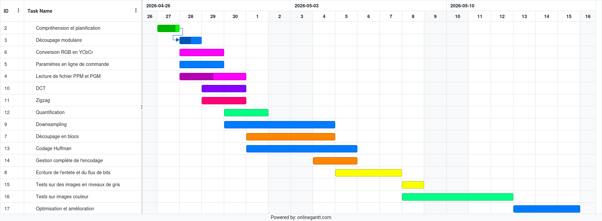
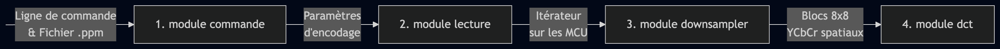
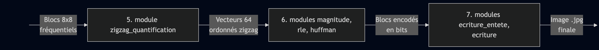

# Projet JPEG - Encodeur Baseline 

**NB :** Projet réalisé dans un cadre académique et initialement hébergé sur le GitLab privé de l’école.
Cette version GitHub est une copie destinée à rendre le projet accessible publiquement.


Ce dépôt contient notre encodeur JPEG *baseline* 100 % fonctionnel et optimisé. Il a été réalisé par **Paul Bottner**, **Abdoul Goudouss Bah** et **Mohamed Khalil Becharai** dans le cadre du module Projet Logiciel.

Ce README rassemble toutes les informations essentielles de notre projet, réparties dans les sections suivantes :

*   [1. Diagramme de Gantt](#diagramme-de-gantt)
*   [2. Enchaînement du pipeline (Flux de données)](#enchaînement-du-pipeline-flux-de-données)
*   [3. Structures de données utilisées](#structures-de-données-utilisées)
*   [4. Répartition des tâches et organisation](#répartition-des-tâches-et-organisation)
*   [5. Optimisations et évaluation des performances](#optimisations-et-évaluation-des-performances)
*   [6. Compilation et Exécution](#compilation-et-exécution)
* [7. Tests et validation](#tests-et-validation)
---

# Diagramme de Gantt



# Enchaînement du pipeline (Flux de données)

Dans cette partie, nous présentons un résumé de notre découpage modulaire et l'enchaînement de l'encodage de l'image source jusqu'au résultat final (l'image compressée au format JPEG).

-   **1) Parsing de la commande d'exécution (module `commande`) :**
    -   *Entrée :* Toute la chaîne de la ligne de commande.
    -   *Sortie :* Tous les paramètres importants pour l'encodage (fichier d'entrée et de sortie, facteurs d'échantillonnage).
-   **2) Lecture du fichier (module `lecture`) :**
    -   *Entrée :* Les paramètres nécessaires (fichier d'entrée et facteurs d'échantillonnage).
    -   *Sortie :* Un itérateur sur les MCU de l'image avec la dimension voulue.
-   **3) Découpage en blocs 8x8 YCbCr (module `downsampler`) :**
    -   *Entrée :* Une MCU RGB ou en niveaux de gris, et les facteurs d'échantillonnage.
    -   *Sortie :* La décomposition de la MCU en blocs 8x8 convertis en YCbCr.
-   **4) Calcul de la DCT (module `dct`) :**
    -   *Entrée :* Un bloc 8x8 spatial d'une composante donnée (Y, Cb ou Cr).
    -   *Sortie :* Un bloc 8x8 fréquentiel.
-   **5) Quantification et ordonnancement Zigzag (module `zigzag_quantification`) :**
    -   *Entrée :* Un bloc fréquentiel 8x8 d'une composante donnée.
    -   *Sortie :* Un vecteur de taille 64 quantifié et réordonné sous forme de zigzag.
-   **6) Encodage des valeurs (modules `magnitude`, `magnitude_rle_huffman`) :**
    -   *Entrée :* Un vecteur de taille 64 quantifié et ordonné en zigzag.
    -   *Sortie :* Le bloc entièrement encodé (bitstream).
-   **7) Écriture dans le fichier de sortie (modules `ecriture_entete` et `ecriture`) :**
    -   *Entrée :* Les informations essentielles pour l'en-tête (tables de Huffman, facteurs d'échantillonnage) et les blocs encodés.
    -   *Sortie :* Une image compressée valide au format `.jpg`.

**Schéma récapitulatif :**




# Structures de données utilisées


# Répartition des tâches et organisation

Concernant notre méthodologie de travail, nous avons commencé par définir un diagramme de Gantt couvrant toute la durée du projet. Ce diagramme a été ajusté lors de la deuxième semaine pour coller à la réalité de notre avancement. Nous avons ensuite adopté une approche itérative en répartissant les tâches chaque matin entre les trois membres de l'équipe. 

Le détail des responsabilités s'organise ainsi :

*   **Paul Bottner :** Parsing des arguments de commande, découpage en MCU et sous-échantillonnage, écriture du flux de bits (bitstream), et orchestration générale dans le `main`.
*   **Abdoul Goudouss Bah :** Calcul de la DCT, quantification, ordonnancement en zigzag, et algorithme d'encodage de Huffman.
*   **Mohamed Khalil Becharai :** Lecture du fichier `.ppm` en superblocs de MCU, encodage des magnitudes, et écriture de l'en-tête du fichier `.jpg`.

> **Validation :** Chaque membre de l'équipe est responsable de la rédaction et de l'exécution des tests unitaires associés à ses modules pour en garantir la robustesse.

# Optimisations et évaluation des performances

Afin d'évaluer objectivement les performances de notre encodeur, nous avons utilisé deux approches, en effectuant nos tests principalement sur l'image `biiiig.ppm` pour mettre en évidence les gains de temps.

*   **Mesures internes :** Calcul du temps d'exécution de chaque grande étape dans le `main` à l'aide des fonctions de la bibliothèque `<time.h>`.
*   **Outils externes :** Utilisation de la commande `time` pour le temps global, et de `gprof` pour générer un rapport détaillé du temps passé dans chaque fonction.

Voici le détail des optimisations techniques appliquées à chaque étape de l'encodage :

**Calcul de la DCT :**
Nous sommes passés d'une implémentation initiale naïve en $O(N^4)$ à une version optimisée en $O(N^2 \log{N})$.
*   **Séparabilité & Algorithme rapide :** Nous utilisons l'algorithme de DCT rapide 1D de *Arai, Agui et Nakajima (1988)*. Au lieu d'un calcul 2D lourd, on applique cet algorithme ultra-rapide sur les lignes, puis sur les colonnes.
*   **Notre optimisation (le `pad`) :** Nous avons modifié l'algorithme pour intégrer un pas de lecture en mémoire (`pad`). Cela permet d'appliquer la DCT sur les colonnes en sautant de 8 cases en 8 cases, ce qui nous évite totalement de devoir transposer la matrice en mémoire.

**Lecture du fichier :**
Afin d'éviter de charger l'image complète en mémoire (ce qui est critique pour les fichiers volumineux), nous avons mis en place une lecture par lots. L'image est lue par morceaux fixes de 64 MCU, optimisant ainsi le nombre de lectures mémoire.

**Conversion RGB vers YCbCr :**
*   **Tableaux statiques :** Pour éviter de recalculer les formules à chaque pixel, nous avons créé des tableaux statiques précalculés.
*   **Opérations bit-à-bit :** Nous avons remplacé les multiplications/divisions par 2 par des opérations de décalage de bits (`>>` et `<<`), beaucoup plus rapides pour le processeur.

**Encodage (Magnitude, RLE, Huffman) :**
*   **Réduction des branches :** Pour le calcul des magnitudes et des indices, nous avons éliminé quelques conditions (`if`) en utilisant des masques de bits sur les signes, évitant ainsi les pénalités de prédiction de branchement. Les multiplications par une puissance de 2 ont là aussi été remplacées par des décalages.
*   **Accès en $O(1)$ pour Huffman :** Les arbres de Huffman originaux ont été transformés en tableaux. Cela permet de remplacer le parcours de l'arbre en $O(\log n)$ par un simple accès mémoire direct en $O(1)$.
*   **Fusion du pipeline :** Nous avons fusionné les trois étapes (Magnitude, RLE, Huffman) en une seule grande fonction. Cela évite l'allocation de tableaux intermédiaires et supprime le coût d'appel des fonctions à chaque bloc.

**Ordonancement en Zigzag et Quantification :**
Nous avons également effectué ces deux étapes en simultané pour éviter de parcourir le bloc plusieurs fois.

**Échantillonnage et découpage en blocs :**
*   **Extraction des invariants :** Factorisation des boucles en sortant les calculs répétitifs à l'extérieur. 
*   **Nettoyage des boucles internes :** Les conditions (`if`) ont été sorties des boucles les plus profondes.
*   **Initialisation :** Utilisation de vecteurs de flottants dès le découpage et application du décalage de niveau (-128) directement lors de l'extraction pour préparer les données pour la DCT sans ajouter de boucle de parcours supplémentaire.

# Compilation et Exécution

Pour la compilation de notre projet, nous nous sommes appuyés sur le `Makefile`  fourni par l'équipe pédagogique, auquel nous avons ajouté quelques règles spécifiques pour nos tests de performances.

**Commandes d'analyse :**
Afin de réaliser les mesures de performances et le profilage évoqués dans la section précédente, nous avons ajouté les règles suivantes :
*   `make compile`, `make compile_2`, `make compile_3` : Force une compilation directe (sans fichiers objets intermédiaires) avec les différents niveaux d'optimisation de GCC (`-O0`, `-O2`, `-O3`). Idéal pour comparer rapidement les temps d'exécution.
*   `make gprof` : Compile le projet avec l'option d'instrumentation `-pg`, exécute automatiquement l'encodage sur l'image de test `biiiiiig.ppm`, et génère le fichier `gmon.out` nécessaire à la lecture du rapport de profiling.

**Exécution de l'encodeur :**
Une fois compilé, l'exécutable s'utilise de la manière suivante :

```bash
./ppm2jpeg [options] fichier_entree.ppm [fichier_sortie.jpg]
```

# Tests et validation

La fiabilité et la conformité de l'encodeur ont été validées via une chaîne de test rigoureuse :

* **Tests unitaires (Framework Unity) :** Écriture et enrichissement régulier de tests unitaires dédiés pour valider isolément la logique de chaque composant (encodage binaire, itérateur mémoire, calculs DCT, tables de Huffman).
* **Validation sur le banc d'intégration et de conformité :** Tout au long du développement, notre implémentation a été soumise à la suite de tests automatisée du projet, validant avec succès :
  * **La fidélité d'image :** Conformité visuelle évaluée face à `convert` via des métriques objectives (SSIM, PAE, AE).
  * **L'efficacité algorithmique :** Suivi du nombre d'instructions machine par pixel (via Valgrind/Callgrind).
  * **L'intégrité mémoire :** Absence d'erreurs ou de fuites mémoires vérifiée sous *Sanitizers* et suivi de l'empreinte mémoire résidente (RSS)[cite: 2].